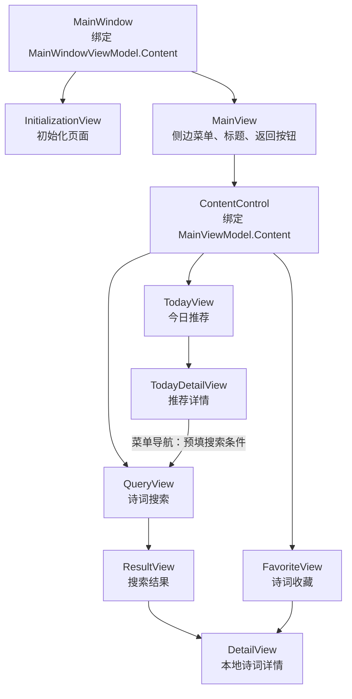

# DailyPoetryA 项目架构与导航机制分析

分析日期：2026-10-10  
分析范围：项目入口、依赖注入、视图绑定、ViewModel、导航服务、数据服务和相关单元测试。

项目采用 **Avalonia 桌面界面 + MVVM + 依赖注入 + 自定义导航服务**。导航的核心操作是：**切换当前 ViewModel，由 `ViewLocator` 将它转换为对应的 View；内容页的返回历史由 `MainViewModel` 维护。**

本文基于当前源码。相关单元测试已运行，14 项全部通过；界面生命周期及绑定问题尚未通过实际启动界面验证。

## 1. 整体架构

解决方案包含三个项目：

| 项目 | 职责 | 主要内容 |
|---|---|---|
| `DailyPoetryA` | 应用入口、界面和平台实现 | XAML 视图、转换器、导航实现、弹窗、依赖注入注册、视图定位 |
| `DailyPoetryA.Library` | 页面状态、业务逻辑和数据访问 | ViewModel、模型、服务接口、SQLite、HTTP、文件缓存 |
| `DailyPoetryA.UnitTest` | 验证业务行为 | xUnit + Moq，测试 ViewModel 和存储服务 |

应用项目和测试项目都引用 `Library`。导航接口定义在 `Library`，实现位于应用项目，因此业务 ViewModel 可以通过接口发起导航，测试中则替换为 Mock。

这个划分适合教学，但 `Library` 同时包含业务逻辑和基础设施实现，而且使用了 Avalonia 无限滚动集合，界面框架与业务库之间仍有一定耦合。

### 1.1 MVVM

- **View**：使用 `.axaml` 描述界面，通过属性绑定显示数据，通过 `Command` 响应操作。多数后台代码只有 `InitializeComponent()`。
- **ViewModel**：维护页面状态、命令和业务流程。`ViewModelBase` 继承 `ObservableObject`，属性使用 `SetProperty` 通知界面更新；操作使用 `RelayCommand`、`AsyncRelayCommand`。
- **Model 与服务**：模型表达诗词、推荐、图片和收藏数据；服务负责数据库、网络、缓存及导航等能力。

源码入口：[ViewModelBase.cs](DailyPoetryA.Library/ViewModels/ViewModelBase.cs)。

### 1.2 依赖注入与服务定位

依赖注入集中在 [ServiceLocator.cs](DailyPoetryA/ServiceLocator.cs)：创建 `ServiceCollection`，注册 ViewModel 和服务，再调用 `BuildServiceProvider()` 构建容器。

**所有已注册的 ViewModel 和服务都是单例。** 同一个页面 ViewModel 会在后续导航中重复使用。

项目结合了两种方式：

1. 业务 ViewModel 通过构造函数注入接口，依赖明确，便于测试。
2. 导航实现通过 `ServiceLocator.Current` 获取目标 ViewModel 和容器 ViewModel。

`ServiceLocator` 在 [App.axaml](DailyPoetryA/App.axaml) 中注册为应用资源；`Current` 从应用资源读取该对象并缓存。

MVVM 管理页面如何表达状态和响应操作，依赖注入管理这些对象如何创建并取得依赖；导航服务把两者连接起来。

## 2. 界面容器结构

界面包含两层内容容器：

- 外层 `MainWindowViewModel.Content`：决定应用显示初始化页面还是主界面。
- 内层 `MainViewModel.Content`：决定主界面的内容区域显示哪个业务页面。



上图表达容器关系和业务跳转，初始化页进入主界面的过程见第 7 节。

对应绑定位于 [MainWindow.axaml](DailyPoetryA/Views/MainWindow.axaml) 和 [MainView.axaml](DailyPoetryA/Views/MainView.axaml)。主界面使用 `SplitView` 显示侧边菜单，用 `ContentControl` 显示当前内容。

## 3. 三种导航服务

三种导航服务的区别在于修改哪个容器，以及怎样处理历史。

| 服务 | 目标页面 | 核心行为 |
|---|---|---|
| `RootNavigationService` | 初始化页、主界面 | 替换 `MainWindowViewModel.Content` |
| `MenuNavigationService` | 推荐、搜索、收藏 | 清空历史，设置菜单首页，更新标题和选中项，关闭侧栏 |
| `ContentNavigationService` | 推荐详情、搜索结果、诗词详情 | 保留历史，将目标页面压入内容栈 |

### 3.1 根导航

[RootNavigationService.cs](DailyPoetryA/Services/RootNavigationService.cs) 根据页面名称获取 `InitializationViewModel` 或 `MainViewModel`，赋给 `MainWindowViewModel.Content`。

根导航用于应用启动阶段的整体界面切换，不维护内容页的返回历史。

### 3.2 菜单导航

[MenuNavigationService.cs](DailyPoetryA/Services/MenuNavigationService.cs) 支持 `TodayView`、`QueryView`、`FavoriteView`。

处理顺序：

1. 根据名称获取目标 ViewModel。
2. 参数非空时调用 `SetParameter(parameter)`。
3. 调用 `MainViewModel.SetMenuAndContent(view, viewModel)`。
4. 清空内容栈，把目标 ViewModel 放入栈首。
5. 设置菜单选中项和标题，并关闭侧栏。

侧栏的 `ListBox.SelectedItem` 双向绑定 `SelectedMenuItem`，`Tapped` 事件触发 `OnMenuTappedCommand`，再根据选中项发起菜单导航。

### 3.3 内容导航

[ContentNavigationService.cs](DailyPoetryA/Services/ContentNavigationService.cs) 支持 `TodayDetailView`、`ResultView`、`DetailView`。

它获取目标 ViewModel，参数非空时设置参数，然后调用 `MainViewModel.PushContent(viewModel)`。已有历史保留，目标页面成为当前内容。

三种服务都通过 `switch` 分派目标页面；未知页面名称会抛出“未知的视图”异常。

## 4. ViewModel 如何变成界面

完整导航链路如下：

```text
点击控件
→ 执行 ViewModel.Command
→ 调用导航服务
→ 获取目标 ViewModel，并设置参数
→ 修改容器的 Content
→ 属性通知触发绑定更新
→ ViewLocator 创建或取得对应 View
→ 设置 View.DataContext
→ 显示页面
```

[ViewLocator.cs](DailyPoetryA/ViewLocator.cs) 实现 `IDataTemplate`，并在 `App.axaml` 的 `Application.DataTemplates` 中注册。它匹配 `ViewModelBase` 对象，使用命名约定和反射定位视图：

```text
DailyPoetryA.Library.ViewModels.DetailViewModel
                         ↓ 名称替换
DailyPoetryA.Views.DetailView
```

具体处理：

1. 将完整类型名中的 `ViewModel` 替换为 `View`。
2. 将 `DailyPoetryA.Library.` 替换为 `DailyPoetryA.`。
3. 使用 `Type.GetType` 查找视图类型。
4. 使用 `Activator.CreateInstance` 创建控件，或从缓存获取。
5. 将目标 ViewModel 赋给控件的 `DataContext`。

控件缓存以 **View 类型** 为键。因此同一种页面会复用 View，同时复用单例 ViewModel，搜索条件、结果集合等状态也会保留下来。页面命名和命名空间必须符合约定，否则显示 `Not Found` 提示。

多数页面上的 `d:DataContext` 用于设计时预览；运行时页面的数据上下文由 `ViewLocator` 设置。主窗口则直接通过应用资源绑定 `MainWindowViewModel`。

## 5. 返回栈机制

[MainViewModel.cs](DailyPoetryA.Library/ViewModels/MainViewModel.cs) 使用 `ObservableCollection<ViewModelBase>` 保存历史，索引 `0` 是当前页面。

```text
进入搜索页：  [Query]
执行搜索：    [Result, Query]
打开诗词：    [Detail, Result, Query]
返回一次：    [Result, Query]
返回两次：    [Query]
切换收藏菜单：[Favorite]
```

核心逻辑：

```csharp
public void PushContent(ViewModelBase content) =>
    ContentStack.Insert(0, Content = content);

public void GoBack() {
    if (ContentStack.Count <= 1) {
        return;
    }

    ContentStack.RemoveAt(0);
    Content = ContentStack[0];
}
```

返回按钮绑定 `GoBackCommand`，通过 `CountToBoolConverter` 仅在栈数量大于 `1` 时显示。

由此可以确定以下行为：

- 切换菜单会丢弃当前导航历史，目标菜单页成为新的栈底。
- 返回操作只在当前内容栈内进行。
- 进入详情不会改变菜单标题。例如从搜索结果进入诗词详情，标题仍然是“诗词搜索”。
- 历史保存的是 ViewModel 引用，不包含独立的参数快照。

## 6. 参数传递与数据加载

`ViewModelBase` 提供 `SetParameter(object parameter)`，具体页面重写该方法。导航服务只在参数非空时调用它。

| 跳转 | 参数 | 目标页面的处理 |
|---|---|---|
| 推荐 → 推荐详情 | `TodayPoetry` | 设置推荐详情数据 |
| 推荐详情 → 搜索 | `PoetryQuery` | 预填标题、作者条件，并重置导航栈 |
| 搜索 → 搜索结果 | `Expression<Func<Poetry, bool>>` | 设置查询条件、清空旧结果、允许继续分页 |
| 搜索结果／收藏 → 诗词详情 | `Poetry` | 设置当前诗词；页面加载时读取收藏状态 |

### 6.1 搜索链路

[QueryViewModel.cs](DailyPoetryA.Library/ViewModels/QueryViewModel.cs) 将非空筛选项转换成字符串 `Contains` 条件，用 AND 连接，再构造表达式树作为结果页参数。

[ResultViewModel.cs](DailyPoetryA.Library/ViewModels/ResultViewModel.cs) 通过无限滚动集合按每页 **20 条**加载数据。[PoetryStorage.cs](DailyPoetryA.Library/Services/PoetryStorage.cs) 将表达式交给 SQLite 查询，使用 `Where`、`Skip`、`Take` 分页。

### 6.2 推荐与缓存

今日诗词通过 `JinrishiciService` 使用 HTTP 获取，失败时回退到本地诗库。图片通过 `BingImageService` 先读取本地缓存，再检查是否需要更新。

`TodayImageStorage` 保存图片文件和元数据，`FilePreferenceStorage` 保存数据库版本标记、图片元数据及诗词服务 token 等配置。

### 6.3 收藏更新

详情页加载时查询当前诗词的收藏记录，用户切换收藏后调用 `FavoriteStorage.SaveFavoriteAsync`。

```text
详情页切换收藏
→ 保存 SQLite 收藏记录
→ FavoriteStorage 触发 Updated 事件
→ FavoriteViewModel 更新列表
→ 集合通知触发界面更新
```

收藏页在构造函数中订阅该事件，因此列表更新也依赖服务事件，而非仅依赖重新进入页面。

## 7. 启动与初始化流程

预期启动流程如下：

```text
Program.Main
→ 配置并启动 Avalonia
→ App 加载应用资源、ServiceLocator、ViewLocator
→ 创建 MainWindow
→ 窗口 Initialized 事件触发初始化命令
→ 检查诗库和收藏库版本标记
  ├─ 已初始化：根导航进入 MainView → 菜单导航进入 TodayView
  └─ 未初始化：根导航进入 InitializationView
               → 复制内嵌诗库、创建收藏表、写入版本标记
               → 根导航进入 MainView → 菜单导航进入 TodayView
```

主要代码位于 [Program.cs](DailyPoetryA/Program.cs)、[App.axaml.cs](DailyPoetryA/App.axaml.cs)、[MainWindowViewModel.cs](DailyPoetryA.Library/ViewModels/MainWindowViewModel.cs) 和 [InitializationViewModel.cs](DailyPoetryA.Library/ViewModels/InitializationViewModel.cs)。

初始化完成后还有一次 `Task.Delay(1000)`，随后执行主界面和今日推荐导航。上述流程描述源码意图，首次启动的绑定和生命周期仍需界面验证。

## 8. 当前实现的问题与改进方向

### 8.1 一处导航服务使用错误

`TodayViewModel.Query()` 将 `MenuNavigationConstant.QueryView` 交给了 `IContentNavigationService`，但内容导航实现没有 `QueryView` 分支，调用会抛异常。

目前推荐页 XAML 没有绑定这个命令；推荐详情页的搜索按钮使用 `IMenuNavigationService`，走的是正确路径。

建议统一通过菜单导航切换到搜索页。源码：[TodayViewModel.cs](DailyPoetryA.Library/ViewModels/TodayViewModel.cs)。

### 8.2 初始化命令可见性需要修正并验证

`InitializationViewModel.OnInitializedCommand` 声明为 `private`，而初始化页 XAML 绑定了该属性。

建议改为 `public`，并验证首次启动是否能执行初始化、完成页面切换。现有测试直接调用方法，无法验证 XAML 命令绑定及事件触发时机。

### 8.3 单例页面无法独立保存多份历史状态

导航栈保存对象引用。同一个单例详情 ViewModel 多次入栈时，新的参数会覆盖之前的状态，历史项无法独立保存不同诗词；搜索结果页也有同类限制。

建议根据需求选择页面级实例，或将页面标识和参数快照作为独立导航记录保存。只调整 ViewModel 生命周期时，也需要同步考虑当前按 View 类型缓存控件的策略。

### 8.4 页面初始化不等于每次进入

推荐页、收藏页通过 `Initialized` 触发加载，详情页通过 `Loaded` 读取收藏状态。由于 View 被缓存，代码缺少统一的“进入页面”生命周期，无法直接表达每次导航需要执行哪些刷新操作。

建议为导航引入明确的进入、离开及异步加载约定，并区分首次初始化和每次进入时的刷新。

### 8.5 异步加载缺少统一管理

推荐页启动两个未等待的 `Task.Run`，并在后台修改绑定属性，缺少统一的异常观察和取消机制。快速导航及退出时的行为值得进一步验证。

建议使用可等待的异步命令或生命周期方法，明确界面线程更新策略，并按需求引入取消机制。

### 8.6 参数与页面标识的约束较弱

当前导航使用字符串页面标识和 `object` 参数，部分 `SetParameter` 遇到错误类型会直接返回；参数为空时也不会重置原状态。

建议在需要扩展时引入类型明确的导航请求或集中注册表，并明确每个页面对于空参数、无效参数和状态保留的规则。

## 9. 验证记录与边界

已运行以下测试命令：

```powershell
dotnet test DailyPoetryA.UnitTest/DailyPoetryA.UnitTest.csproj --filter 'FullyQualifiedName~MainViewModelTest|FullyQualifiedName~MainWindowViewModelTest|FullyQualifiedName~TodayDetailViewModelTest|FullyQualifiedName~QueryViewModelTest' --verbosity minimal
```

结果：**通过 14 项，失败 0 项，跳过 0 项。**

这些测试验证了主界面菜单状态、入栈和返回行为、窗口启动分支、推荐详情到搜索页的参数传递，以及搜索条件的部分处理。

测试项目只引用 `Library`，因此这些结果尚不能证明应用层导航实现、反射视图定位和 XAML 事件绑定都能正常工作。未执行完整测试套件或实际界面启动验证。测试构建中存在编译和分析器警告，其中 `TodayViewModelTest.QueryCommandFunction_Default` 缺少 `[Fact]`，不会作为测试执行。
