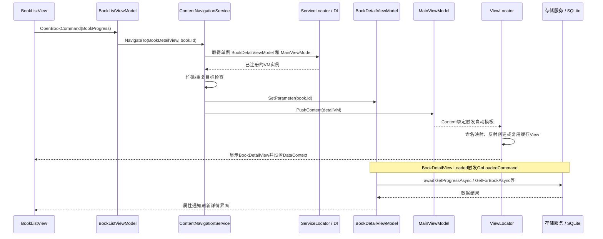

# 当前项目与指导书架构对应说明

检查日期：2026-10-21。范围：当前工作区 `Code/`，对照原始指导书及本地 `daily-poetry-a/` 参考源码。仅检查和整理，不修改应用或正式报告。

## 结论与要求边界

在本轮源码审查和架构相关测试范围内，指导书八项架构要求均有对应实现；真实 IoC 容器、单例、应用资源定位器、三层导航、统一参数入口、主 VM 返回栈和反射视图定位等具体机制也与 DailyPoetryA 对应。

指导书“技术与架构要求”明确：只需要反映对应思想，无需采用一模一样的技术。项目既有已确认约束进一步要求保留参考的具体调用机制，本次也按该约束核对。不能把业务功能名称相同、页面截图相似当作架构对应依据。

“双工程分层”指 UI 与 Library 的工程依赖；“三层导航”指 Root/Menu/Content 的交互职责，两者不是同一个分层维度。解决方案还包含 UnitTest 工程。

## 一、工程和职责对应

```text
DailyPoetryA                         当前阅记
DailyPoetryA/                        Code/ReadJournal/
  Views/                              Views/：XAML、薄 code-behind
  ServiceLocator.cs                   ServiceLocator.cs：集中组装和解析依赖
  ViewLocator.cs                      ViewLocator.cs：VM 自动映射 View
  Services/*NavigationService         Services/*NavigationService：导航的平台实现
  Services/AlertService               Services/AlertService、FileService：平台交互

DailyPoetryA.Library/                Code/ReadJournal.Library/
  Models/                             Models/：Book、ReadingRecord、Quote、ReadingPlan 等
  ViewModels/                         ViewModels/：状态、命令、页面协调
  Services/                           Services/：接口、存储和业务服务

DailyPoetryA.UnitTest/               Code/ReadJournal.UnitTest/
```

实际依赖为 UI → Library；Library 不反向引用 UI，也不引用 Avalonia。Library 使用 MVVM Toolkit 和 SQLite，因此“可跨 UI 框架复用”不等于“完全不依赖数据库技术”。指导书第1项把 Views 写在 Library 描述中，但参考实际工程和第8项均把 Views 放在 UI 壳；本项目与实际参考结构一致。

## 二、八项要求逐条对应

| 指导书要求 | DailyPoetryA 的机制 | 当前项目的实现与依据 | 判断 |
|---|---|---|---|
| 1. MVVM 视图与视图模型分离 | Models 放实体，VM 管交互，Views 管显示与绑定 | `ReadJournal.Library/Models/Book.cs:3` 是带 SQLite 映射的实体；`ViewModels/BookListViewModel.cs:21` 接收服务、定义命令并加载状态；UI `Views/BookListView.axaml` 绑定状态和命令；普通视图 code-behind 仅初始化，`MainWindow.axaml.cs:6` 将关闭事件转交 VM 检查 | 对应 |
| 2. 统一导航参数入口 | `ViewModelBase.SetParameter(object)`，导航切换前调用 | `ReadJournal.Library/ViewModels/ViewModelBase.cs:27` 定义虚方法；`BookDetailViewModel.cs:54` 覆写并保存书籍 ID；UI `Services/ContentNavigationService.cs:20` 注参，再调用 `PushContent`。菜单服务同样先注参再切换 | 对应 |
| 3. IService 抽象与面向接口 | VM 构造函数依赖存储、导航、提示等接口 | `BookListViewModel.cs:21` 注入 `IBookStorage`、`IContentNavigationService`；`BookStorage.cs:3` 实现 `IBookStorage`；`ServiceLocator.cs:25` 起配置接口映射。14 个服务/导航接口均注册在真实容器中 | 对应 |
| 4. 轻量 ServiceLocator 与 IoC | ServiceCollection → AddSingleton → BuildServiceProvider → GetService；Current 从应用资源取得 | `ReadJournal/ServiceLocator.cs:10/17/23/53/55` 依次持有 IServiceProvider、取应用资源、创建集合、构建容器、解析 VM；`App.axaml:11` 注册资源。共29项单例注册：14个VM、14个接口映射、DataPaths | 对应 |
| 5. 三层服务化导航 | Root 改窗口 VM.Content；Menu 调 SetMenuAndContent；Content 调 PushContent；主 VM 管栈 | 三接口和常量在 `ReadJournal.Library/Services/I*NavigationService.cs`；UI 三实现分别在 `Services/`；`MainViewModel.cs:13/32/37/42` 管栈、压栈、菜单清栈和返回，接口没有栈状态 | 对应 |
| 6. ViewLocator 自动渲染 | 按类型名约定寻找 View，反射创建，按类型缓存并设置 DataContext | `ReadJournal/ViewLocator.cs:12` 替换类型名和命名空间，`:13` Type.GetType，`:15` Activator.CreateInstance及缓存，`:16` 绑定DataContext；`App.axaml:12` 注册模板 | 对应 |
| 7. IO 副作用服务化与异步协作 | VM 调可注入服务；数据、文件和UI反馈由服务执行 | `BookListViewModel.cs:32` await存储接口；`BookStorage.cs:16` 负责查询；`DatabaseService.cs:18/51` 将数据库工作放到Task.Run并串行化；`FileService.cs:13/17` 异步读写；`AlertService.cs:20/22` 封装确认和模态编辑。VM目录的直接文件/HTTP/SQLite连接及数据库委托调用扫描无命中 | 对应 |
| 8. Library/UI 双工程边界 | 核心实体、接口、服务、VM在Library；Views、容器和平台服务在UI | `ReadJournal.Library.csproj:1` 不引用Avalonia/UI；`ReadJournal.csproj:1` 引用Library并引入Avalonia、DI等。导航接口与常量在Library、导航实现位于UI，与真实参考一致 | 对应 |

表内路径从 `Code/` 起算；未逐行列出的参考依据为本地相应同名文件，具体来源见 `source-notes.md`。

## 三、三层导航各自切换什么

| 层次 | 接口与实现 | 目标 | 状态如何变化 |
|---|---|---|---|
| Root | IRootNavigationService / RootNavigationService | InitializationView、MainView | 替换 MainWindowViewModel.Content，决定窗口内显示初始化界面还是主界面 |
| Menu | IMenuNavigationService / MenuNavigationService | 概览、书库、书摘、阅读计划、统计、设置 | 调 MainViewModel.SetMenuAndContent，清空旧栈，将菜单页设为新栈底并更新标题 |
| Content | IContentNavigationService / ContentNavigationService | 书籍详情、书籍编辑、书摘编辑、计划编辑 | 调 MainViewModel.PushContent，将内容VM插入栈首，返回时由主VM移除栈首并恢复上一页 |

Root 中没有反复创建新 Window；与参考源码相同，它改变现有窗口绑定的 Content。MainView 的 ContentControl 直接绑定 MainViewModel.Content，没有额外的 ShellViewModel 或导航宿主。三类导航使用常量选择目标VM，不负责创建View。

## 四、从书架进入详情的真实调用链



对应位置：`BookListViewModel.cs:24` → `ContentNavigationService.cs:10/19/20/21` → `BookDetailViewModel.cs:54` → `MainViewModel.cs:35` → `Views/MainView.axaml:1` → `ViewLocator.cs:12–16` → `Views/BookDetailView.axaml:2` → `BookDetailViewModel.cs:55`。图中V泛指当前展示的界面，显示详情后实际控件为BookDetailView。

返回由MainView中的GoBackCommand触发，经离开检查后调用MainViewModel.GoBack；切换菜单则经OnMenuTappedCommand调用菜单服务。返回保留原栈，菜单切换建立新栈底。

## 五、与参考不同但保留核心机制的扩展

1. **单例状态清理**：参考只有非空参数才SetParameter；当前菜单/内容导航即使空参数也调用，以清除新建编辑页的旧状态。入口和“先注参、再显示”的顺序保持。
2. **导航和异步保护**：增加IsBusy、CanLeaveAsync、ParameterVersion、重复目标检查和加载等待；编辑页有未保存草稿确认。栈仍由主VM维护，没有转移到服务接口。
3. **模态阅读记录编辑**：BookDetailViewModel先给ReadingRecordEditViewModel注参，再通过IAlertService.EditRecordAsync打开窗口；窗口Content是VM，仍由ViewLocator渲染。该模态流程不压入主内容栈，不属于第四层导航。
4. **业务服务扩充**：以书籍、记录、书摘、计划、统计和备份服务替换诗词/每日推荐服务。当前为离线阅读管理，没有网络功能不构成IO服务化缺失；对应思想体现在现有文件、数据库和UI交互的封装中。
5. **可移植性边界**：Library中IDatabaseService仍暴露SQLiteConnection委托，IAlertService也接受业务VM；可复用到其他UI不等于纯领域层或完整数据库无关架构。当前业务VM没有执行数据库查询委托。

## 六、本轮验证与规模

- 使用现有Roslyn工具重新统计，不计测试、bin/obj和生成代码，分部类去重：参考63类、10接口、9个视图；当前66类、14接口、14个视图。参考70%门槛为45类、7接口；页面门槛为9。当前14视图中扣除主窗口、主容器、初始化和记录模态编辑后，仍有10个业务页面。
- 本地参考55个C#文件、9个视图共64项哈希与既有基线一致；原指导书SHA256仍为`352e94bc9126cc0ef9b5e9f0d293ad8b562bb07b7e17e85aacd7972f918d4d1d`。
- 本轮命令重新构建当前项目并运行既有ArchitectureTests与OverviewArchitectureTests：**12通过、0失败、0跳过**。覆盖真实应用资源与容器、VM/服务单例、构造注入、三层导航、参数与重复目标、返回栈、视图缓存绑定、初始化重试、单例详情状态清理、忙碌导航保护及概览服务边界/真实SQLite查询。
- 测试命令：`dotnet test Code/ReadJournal.UnitTest/ReadJournal.UnitTest.csproj -c Release --no-restore --filter "FullyQualifiedName~ReadJournal.UnitTest.ArchitectureTests|FullyQualifiedName~ReadJournal.UnitTest.OverviewArchitectureTests"`；结果见`docs/evidence/architecture-mapping-20261021/architecture-mapping.trx`，输出见`docs/evidence/architecture-mapping-20261021-test.log`。
- 完整的93项测试和71项运行时架构断言属于此前Windows验收，见`local-audit-20261021.md`，本轮不冒称重新执行了全部93项或71项，也未再次进行桌面点击验收。

## 七、交付和复核边界

本轮仅新增本说明、检查计划和证据，并追加来源/分析/问题记录。未修改raw、参考源码、应用源码、正式Word、源码ZIP或其他正式交付；未联网。无需用户选择新架构，检查范围内没有阻塞问题。

若将本说明纳入报告或答辩，建议用户复核三项表述：Root切换的是窗口内Content；导航三层不等同于工程三层；Library跨UI复用不等同于完全屏蔽SQLite。本说明属于过程文档，不作为新增正式报告放入output。
