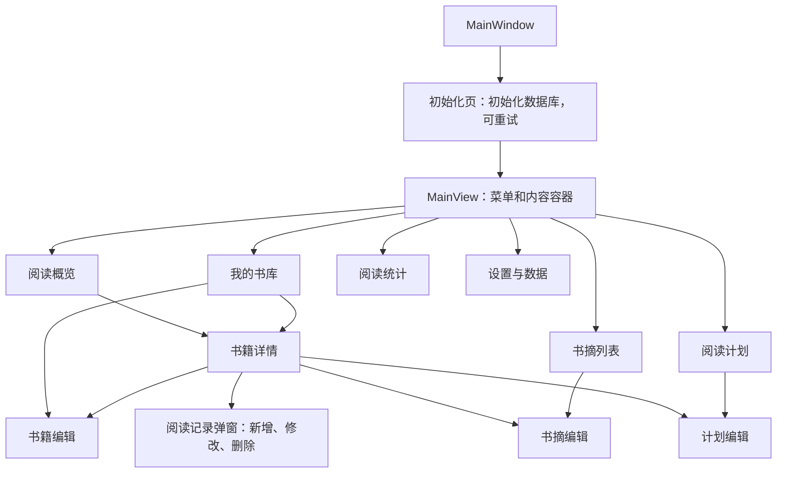
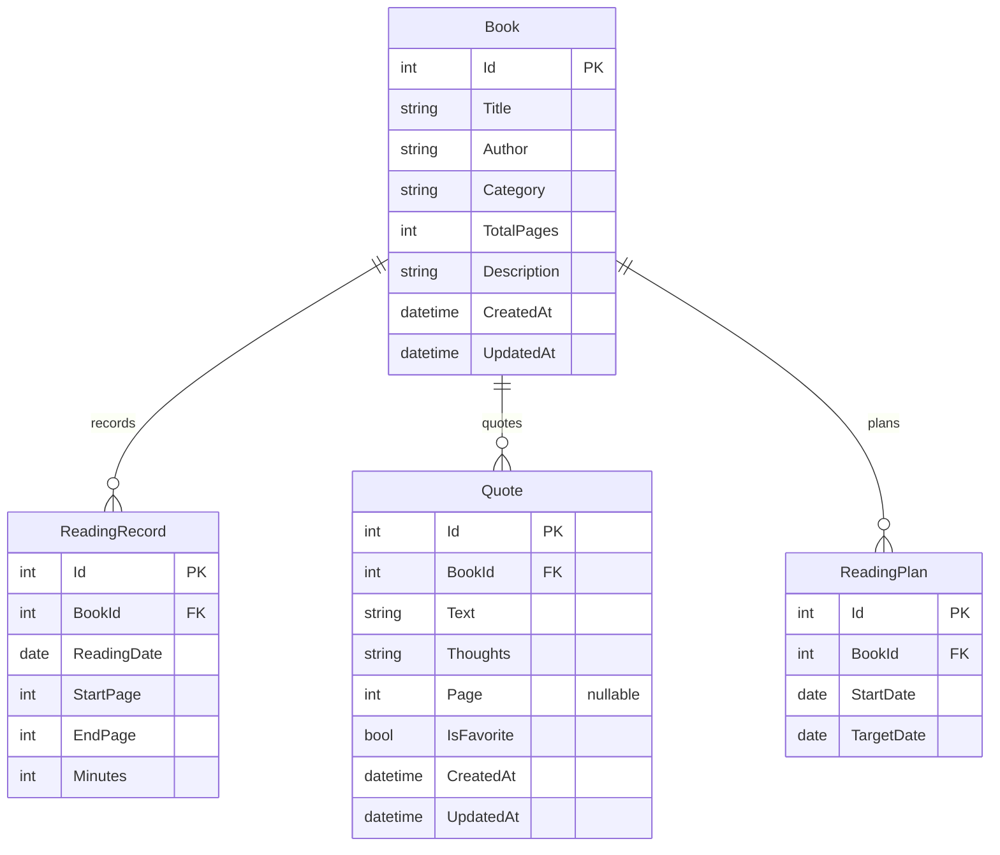

# 阶段 1：需求追溯与业务设计

日期：2026-10-20。依据：`docs/plan.md` v4、只读原始 `raw/期末项目与报告要求.docx` 和本轮用户指令。本文是既定规划的设计细化，不是替代规划；所有类型、页面和检查项均为待实施设计，不代表已实现。初轮编写时参考源码未取得；用户随后推送后已核对，阶段 1 通过，详见 reference-architecture-audit.md。下文的待核验表保留设计时的核对项目。

## 1. 课程要求与验收证据对应

| 来源 | 约束 | 对应设计与后续证据 |
|---|---|---|
| 指导书“功能与工作量要求” | 实际意义、逻辑自洽 | 个人离线记录；书籍、记录、书摘、计划互相关联，无账号或在线功能 |
| 同上；规划 §1、§2 | 页面不少于参考项目 | 十个业务视图，另有初始化页、主窗口和主容器；阶段 5 以真实可达页面清单及截图核验 |
| 同上；规划 §1 | 类和接口分别达到参考项目的 70% | 保留已有参考清单和 Roslyn 脚本；取得源码后重新运行。开发目标 50 类、至少 10 接口，当前应用实现数量为零 |
| 同上；规划 §6 | 只交源码和必要资源，不包含编译结果 | Code 内显式白名单；新目录解压后还原、构建、测试、启动；压缩包 ≤ 10,000,000 字节 |
| 指导书“技术与架构要求”；规划 §3 | MVVM、构造注入和真实 IoC | UI/Library 分层；ServiceCollection → BuildServiceProvider → IServiceProvider → GetService；真实解析测试 |
| 同上；本轮用户“二” | 保留参考核心调用机制 | 源码对照定位器、导航、主 VM、常量、参数入口、ViewLocator、App 资源；参考不可用前不得宣称核验完成 |
| 规划 §4、§5 | 数据一致性和边界条件 | SQLite 临时库集成测试；事务故障和恢复失败注入；进度、计划和统计从有效记录重算 |
| 指导书“报告模板”；规划 §6 | 固定章节、PDF 格式 | 已有 report-checklist.md；只能填实际实现和执行证据，导出后逐页核验 |

指导书允许不同技术实现，用户和规划进一步要求严格保留参考项目具体机制，两者可同时满足。指导书有关目录的概述不能替代真实源码定位；导航常量的实际文件位置须取得源码后复核，不能把已有过程文档当成源码。

## 2. 页面流转与调用边界

根导航只切换 MainWindowViewModel.Content；菜单导航经常量定位单例后 SetParameter，再 SetMenuAndContent 并清空返回栈；内容导航经常量定位单例后 SetParameter，再 PushContent。显示后由公开 Loaded 异步命令加载。GoBack 由 MainViewModel 管理，返回到受影响页面时刷新数据并保留可用搜索条件。

本项目新增的业务保护：在调用 SetParameter **之前** 判断目标是否已经在栈中；重复请求不覆盖单例当前参数。编辑页离开确认、异步命令防重入、重新接收参数清理旧草稿和过期数据均属于新增保护，不能归称为参考原有机制。构造函数仅保存依赖、建立命令，不导航、不加载数据。

返回、菜单、关闭窗口共用保存/放弃/取消离开语义；保存失败留在当前编辑页。书籍详情中的记录弹窗不计页面数。每个列表都要呈现首次空库、查询无结果、加载失败与重试状态。

## 3. 数据关系与一致性

数据库初始化服务管理 schema 版本与外键启用；共享写入串行化。所有跨表操作使用同一事务边界，不能把多个独立存储调用误当原子事务。书籍删除须先提示关联数量，确认后同事务删除四表关联业务数据；删除计划不删除阅读记录。偏好独立保存在本地应用数据目录，不属于业务备份。

进度和计划状态为派生结果，不把陈旧副本作为唯一事实源。累计页数为每条 `EndPage - StartPage + 1` 的和，当前页为最大 EndPage，无记录为 0。完成日期取所有读至末页记录的最早阅读日期。总页数变化须先检查记录与书摘最大页码，再重算上述状态。

每本书最多一个未完成计划；状态根据当前有效记录、本地当天和目标日派生。未逾期每日建议为 `ceil(剩余页数 / (目标日 - 今天 + 1))`；完成为 0，逾期独立展示剩余页数。日期按用户运行应用时的本地日期计算，不能固定为开发日期。

恢复流程：完整读取 JSON → 验证版本、实体字段、ID、外键及业务约束 → 成功写出当前库的自动备份 → 一个事务内替换四类业务数据 → 成功后刷新页面。自动备份失败不得进入替换，事务失败原库完整保留。演示数据只可在空业务库中载入并明确标注虚构。

## 4. 类型职责分配（设计清单，不预建空类型）

| 所属工程 | 类型或类型组 | 实际职责 |
|---|---|---|
| Library | Book、ReadingRecord、Quote、ReadingPlan | 四类业务实体及持久化字段 |
| Library | ViewModelBase | 属性通知基础和统一 SetParameter(object parameter) |
| Library | MainWindowViewModel、InitializationViewModel | 根内容与初始化/失败重试状态 |
| Library | MainViewModel | 菜单命令、菜单状态、Content、ContentStack 及返回行为 |
| Library | OverviewViewModel、BookListViewModel、BookDetailViewModel、BookEditViewModel | 概览、搜索分页、详情与书籍草稿校验 |
| Library | QuoteListViewModel、QuoteEditViewModel | 书摘搜索、收藏与编辑 |
| Library | ReadingPlanListViewModel、ReadingPlanEditViewModel | 计划状态列表与目标日期编辑 |
| Library | StatisticsViewModel、SettingsViewModel | 统计加载、主题偏好与备份/恢复/演示入口 |
| Library | 阅读记录弹窗所需 ViewModel | 新增/修改记录、输入校验、重读输入；随阶段 3 确定实际拆分 |
| Library | 数据库初始化接口与实现 | 本地数据路径、schema 版本、初始化及连接/事务协作 |
| Library | 四类存储接口与实现 | 书籍、记录、书摘、计划的参数化查询和持久化 |
| Library | 偏好接口与实现 | 主题读写，与业务备份隔离 |
| Library | 阅读业务接口与实现 | 跨实体校验、记录闭区间、进度及完成重算 |
| Library | 统计接口与实现 | 全量数据累计指标、完成数、近七日趋势 |
| Library | 备份接口与实现 | 版本化 JSON、完整校验、自动备份和事务恢复 |
| Library | IAlertService、文件选择接口 | 可注入的提示、选择和确认能力，不依赖 Avalonia 控件 |
| Library | 三个导航接口及同文件中的三类常量 | 根、菜单、内容导航协议及固定目标名称 |
| UI | ServiceLocator | 构造内注册全部单例、持有真实容器、资源 Current 缓存和 VM 属性解析 |
| UI | 三个导航实现 | 方法执行时通过 Current 延迟定位，不能反向构造注入主 VM |
| UI | ViewLocator | IDataTemplate、命名替换、反射、视图缓存、DataContext |
| UI | App、Program、主窗口、容器及各页视图 | 启动、资源与模板注册、薄视图代码及绑定 |
| UI | 提示和文件选择实现 | Avalonia 平台交互与窗口关闭协作 |
| UnitTest | 按模块的测试类型 | 临时真实 SQLite 库、Moq 依赖隔离、业务和架构测试；不计入应用类型数量 |

上述服务职责合计仍按规划 14 项：数据库初始化、四类存储、偏好、阅读业务、统计、备份、提示、文件选择、三层导航。具体文件和辅助数据投影在各阶段按真实需求建立，完成闭环后再统计，不能把本表行数当实际类数量。

## 5. 参考源码核对闸门

以下都是尚未执行的源码核验：

| 必读路径（参考仓库相对路径） | 需要核验 |
|---|---|
| DailyPoetryA/ServiceLocator.cs | 局部注册、真实容器、属性解析、全部生命周期、Current 缓存 |
| DailyPoetryA/App.axaml、App.axaml.cs | 资源、模板注册及启动接入 |
| DailyPoetryA/ViewLocator.cs | IDataTemplate、反射与视图缓存、DataContext |
| DailyPoetryA/Services/*NavigationService.cs | 三层定位和调用顺序、目标映射 |
| DailyPoetryA.Library/Services/I*NavigationService.cs | 签名、默认参数、三类常量 |
| DailyPoetryA.Library/ViewModels/MainViewModel.cs | 构造依赖、内容与菜单状态、返回栈、公开命令绑定 |
| DailyPoetryA.Library/ViewModels/ViewModelBase.cs | 参数入口与通知基础 |
| 两个应用工程、测试工程的 csproj 及解决方案 | 真实依赖版本、项目边界和构建结构 |
| 所有 55 个清单源文件和 9 个视图 | 与保留 SHA256 核对，再执行语法树统计；不能凭清单代替源码 |

阶段 1 通过前须取得这些实际源码，核对并记录具体位置；不得仅依据本设计进入阶段 2。
