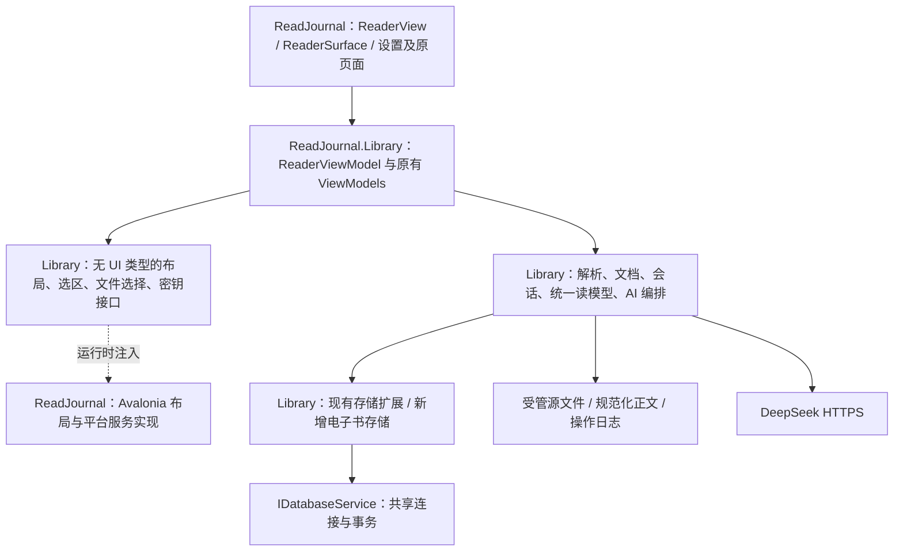

# 阅记：原生电子书阅读器与 AI 阅读助手完整实施规划 v2

编制日期：2026-10-22。性质：本轮完整规划交付，后续开发与验收依据；不是已实现功能说明。

代码基线：`Zhoubin601/FullStackWork`，提交 `2133786762fcfcac1906f3b07afa5460fde9a998`，应用工作目录 `Code/`。本轮先前查询时本地与远端 main 一致。

本文件承接用户 v1 草案及可行性评估，补齐接口、数据语义、旧系统兼容、故障处理、阶段边界和验收门槛。用户已要求直接生成完整规划，无需重复确认大纲。

配套文件：

- [接口与数据契约 v1](20261022-阅记-接口与数据契约-v1.md)：类型、服务签名、持久化结构和并发契约。
- [分阶段实施与验收执行表 v1](20261022-阅记-分阶段实施与验收执行表-v1.md)：P0～P10 的逐步执行、验收编号、证据和停止条件。

## 1. 总目标与发布边界

在保留现有阅读管理功能和指定架构的前提下，形成以下完整链路：

> TXT/EPUB 导入受管书库 → 原生分页阅读 → 稳定位置续读 → 正常离开自动生成会话 → 统一阅读历史、统计与计划 → 手动/AI 书摘 → 原文回跳 → 含书籍文件的备份恢复。

### 1.1 本次规划包含

| 领域 | 必须实现的行为 |
|---|---|
| TXT | BOM/UTF-8 与明确指定的 GB18030 编码；换行标准化；章节识别失败时仍能分块阅读 |
| EPUB | 无 DRM、文字为主的流式 EPUB；spine 阅读顺序、目录、基本强调样式和受控本地图片 |
| 阅读 | 主界面内打开、分页、键盘/按钮翻页、目录跳转、全屏、字体/字号/行距/页边距/阅读配色 |
| 位置 | 版本化正文锚点；重排后恢复同一正文；最后位置允许向前回退 |
| 时间 | 正文成功显示后开始，正常离开时结束；不扣除闲置、不判断活跃度、无实时计时器要求 |
| 书库 | 文件选择导入、默认收件区启动扫描/手动刷新、散列去重、失败原因、打开书库目录 |
| 书摘 | 复制、选中存书摘、来源标记、定位回跳、编辑、删除和收藏 |
| AI | DeepSeek：当前页/指定页范围分析、选区解释、原文书摘提取并自动保存、去重与批次撤销 |
| 旧功能 | 手动书籍、手动页码记录、计划、概览、统计、浅深主题、旧 JSON 恢复继续可用 |
| 数据保护 | schema 迁移、完整 ZIP 备份、恢复前自动完整备份、文件操作中断恢复 |
| 交付 | 自动化与 Windows x64 实机验收、文档/README/白名单更新、源码包控制在课程要求范围 |

### 1.2 首版排除

PDF/OCR、MOBI/AZW3、DRM、固定版式 EPUB、复杂 CSS 精确复刻、公式与脚本、云同步、账户、在线书城、全书向量检索、后台整本 AI 分析、双栏精排、多窗口和书库根目录迁移。

图片须在 P7 支持基本等比缩放与分页安放，跨图片选择不作为首版目标；不得用删除全部图片冒充 EPUB 完整验收。

### 1.3 平台及工期口径

Windows x64 为首个发布平台；Linux 用于辅助开发和适配验收；macOS 只有实际完成构建、凭据和界面测试后才能列为支持平台。未实测平台标为未验证。

团队人数、截止日期和真实 EPUB 样本集资料未提供，不据此编造日程或人日。采用阶段验收推进，每阶段结束更新实际耗时与剩余风险。性能数字是目标门槛，不是现有测量结果。

## 2. 必须保留的统一架构

### 2.1 技术基线

- .NET 8、Avalonia 11、CommunityToolkit.Mvvm、sqlite-net-pcl。
- 当前 Avalonia 版本为 11.0.10；不预先承诺必须升级。只有 P1 证明现版本存在阻塞，才做最小兼容升级并重跑架构/主题/输入回归。
- 保留真实 `ServiceCollection → BuildServiceProvider → IServiceProvider → ServiceLocator`。
- 保留服务与 ViewModel 的单例注册要求，以及应用资源中的 `ServiceLocator.Current`。
- 保留根/菜单/内容三层导航、导航常量、`SetParameter(object)`、MainViewModel 持有内容栈与返回逻辑。
- 保留反射 `ViewLocator` 和按 View 类型缓存；新增页面按现有命名规则接入。
- 保留共享 SQLite 连接、串行门禁和 `IDatabaseService.WriteAsync` 事务边界。

不得通过新增第二套数据库、第二个导航壳、替代 ServiceLocator、手写全局 VM 集合或在数据层引用 Avalonia 来绕过原有约束。

### 2.2 责任与依赖方向



接口定义在 Library；UI 工程实现 `IReaderLayoutService`、文件选择、剪贴板、全屏、平台凭据与目录打开等适配。Library 不引用 `Control`、`TextLayout`、`Rect`、`Brush`、Dispatcher 或窗口类型。

ReaderViewModel 仍放 Library。它只处理无 UI 依赖的布局参数、页面标识和范围；需要 UI 线程的文字测量，由注入的 UI 实现自行调度。ReaderSurface 使用同一布局结果进行绘制、命中和选区，不额外按另一套参数排版。

### 2.3 数据访问规则

- SQL 和 SQLite 查询只放存储/查询服务及其内部辅助函数，VM 不持有数据库委托。
- `ReadAsync/WriteAsync` 委托内只执行同步数据库动作和纯计算；不得在其中调用另一个持有同一数据库门禁的异步服务。
- 不在数据库事务内做网络、等待 UI、全文解析或大型文件复制。旧备份逻辑在本次统一改造为协调器保护下的快照与文件处理。
- 一个业务动作需同时写会话与位置、书摘与来源、批次与明细时，使用一次共享事务。
- 读取统一状态时，在同一次数据库读取内取得所需行并交给纯计算器；不为每本书嵌套调用异步存储。

## 3. 统一产品语义

### 3.1 手动书籍与电子书

`Book.Kind`：`Manual=0`、`Ebook=1`，旧数据默认 Manual。手动书必须 `TotalPages>0`；电子书 `TotalPages=0`，展示中隐藏真实总页数输入。

首版不允许把已有手动书直接改成电子书，也不允许电子书改回手动书，避免改变已有记录语义。电子书元数据允许编辑，文件身份与正文版本不变；替换电子书内容另作后续功能。

手动页码记录只关联 Manual；电子书通过会话记录时长。无源文件的电子书不得悄悄变成手动书，应标记“文件缺失”并给出恢复路径。

### 3.2 三种数值各自独立

| 数值 | 定义与持久化 | 界面用途 |
|---|---|---|
| 真实页码 | 仅手动书的 StartPage/EndPage/TotalPages | 原有页数统计与计划 |
| 动态页码 | 某文档与布局版本下的临时页序号，不作为稳定定位 | 阅读页、指定范围操作 |
| 正文进度 | 根据规范化文档中当前锚点对应的累计正文位置计算 | 电子书续读百分比和计划参考 |

百分比区间为 0～100，可回退；跳章后的进度表示当前位置，不声称用户阅读了此前全部文字。电子书不会虚增真实页数。

### 3.3 最后位置、已开始、已完成

- `LastPosition`：最后正常保存的位置；重排页首页可能变化，正文锚点不变。
- `HasStarted`：首次正文成功显示时置为 true；即使位置仍为 0，也应显示“在读”。
- `CompletedAt`：首次明确完成的时间，保持至显式重置。
- 完成触发：在最后一页再次执行“下一页”时显示读完反馈并记录完成，或点击“标记已读完”。单纯跳到最后一页不自动完成。
- 已完成后回看前文，只更新 LastPosition，完成状态与计划保持。
- “重置阅读状态”明确确认后清除 HasStarted/CompletedAt 并回到起点；保留历史会话和书摘。存在多个历史计划且重置会造成冲突时拒绝并要求先处理多余计划，沿用旧一致性原则。

### 3.4 阅读会话与时长

成功显示首屏后创建 SessionId、OpenedAt 和起始位置。解析失败、取消打开不产生会话。页面切换、字号调整不重启会话；离开阅读页、菜单切换、切换书籍、正常关窗结束会话。

使用 DateTimeOffset 表示起止时间，按 ClosedAt−OpenedAt 保存原始毫秒数，不扣除闲置和系统睡眠。无须 UI 计时器。起止时间转换为 UTC ticks 和偏移分钟数持久化，避免依赖 ORM 对 DateTimeOffset 的隐式支持。

电子书会话允许不足一分钟。列表显示“少于 1 分钟”或带秒值，统计先汇总原始时长后再格式化；不把每次短会话向上取整再累加。旧手动记录仍要求整数分钟且大于 0。

系统时钟被调回导致差值为负时保存 0 并标记时钟异常，提示该会话时长需复核；不自动伪造时长。跨天会话按关闭时的本地日期归档，保存当时偏移，不随以后系统时区变更移动日期。

异常终止首版接受未关闭会话和最后未提交位置丢失，启动时不捏造结束时间；这是已知边界。正常关闭的持久化失败必须可重试，不能显示“已保存”后丢数据。

## 4. 数据与版本管理

### 4.1 三套版本分别管理

| 版本 | 首个目标 | 作用 |
|---|---:|---|
| SQLite SchemaVersion | 2 | 数据库表结构迁移 |
| BackupFormatVersion | 2 | ZIP manifest 与数据 DTO 的格式 |
| CanonicalDocumentVersion / ParserVersion | 1 / 1 | 正文序列化及提取规则 |

三者不能用同一个字段替代。布局版本另由文档身份、视口、字体、DPI、样式和排版器版本派生；无需随数据库版本一起增长。

### 4.2 持久化实体

| 实体 | 决定及约束 |
|---|---|
| Book | 保留原字段；增加 Kind、BookUid（唯一 GUID，所有书都有，迁移时生成） |
| Quote（扩展） | 保留原字段；增加 Quote.Revision，任何编辑或收藏变更递增，批次撤销据此避免删除用户已改动项 |
| EbookFile | BookId 唯一 FK；FileId 唯一；格式、相对源路径、SHA-256、字节数、正文摘要、解析版本、规范化正文路径、导入时间、状态 |
| EbookProgress | BookId 主键 FK；DocumentKey、LastPosition、HasStarted、CompletedAt、LastOpenedAt、LastSavedAt；百分比按文档推导，缓存值不作为真值 |
| EbookReadingSession | SessionId 主键；BookId/BookUid/DocumentKey、起止锚点、起止百分比、起止时间及偏移、DurationMilliseconds、CloseLocalDate、ClockAnomaly |
| QuoteOrigin | QuoteId 主键 FK；来源、原始引文、DocumentKey、起止锚点、上下文摘要、BatchId、定位状态 |
| AiGenerationBatch | BatchId 主键；BookUid、DocumentKey、ScopeHash、CreatedAt、状态；不存 API Key |
| AiGenerationBatchItem | BatchId+QuoteId 关联；记录实际新增项和创建时内容版本，用于安全撤销 |

完整列、索引、删除关联和 SQLite 值类型见接口与数据契约。源文件不可变；规范化正文也是稳定锚点的依据，必须保留并纳入完整备份，不能当作可任意删除的临时缓存。

### 4.3 schema 1 → 2

1. 取得应用数据独占维护权，确认无活动阅读会话和写操作；使用 SQLite 一致性备份或关闭连接后的成套快照备份原数据库到时间戳路径，不能复制一个仍有未处理 WAL/journal 的孤立主文件。
2. 打开共享连接检查 user_version，事务内增加列/表/索引，给旧 Book 分配不重复 BookUid，所有旧书 Kind=Manual。
3. 显式保留全部旧主键、关联、时间、页码和文本，不重算旧历史数据。
4. 执行完整性和外键检查，核对行数与字段摘要后设置 user_version=2；失败回滚，不允许进入主业务。
5. 保留迁移前快照；旧程序遇到 schema=2 应明确拒绝，不能直接降级打开。

不能仅调用 CreateTable 就声称迁移完成。先做旧数据库 fixtures，再写迁移代码。迁移失败时仅用于验证的隔离副本可回滚到原版；真实用户回退必须停止应用，并使用成套备份恢复，不覆盖新数据。

## 5. 规范化文档、锚点与排版契约

### 5.1 文档生成

TXT：读取受限流 → 严格编码判定 → CRLF/CR 转 LF → 版本固定的章节/块识别 → 规范化文档。UTF-8 非法时不静默替换乱码；提示按 GB18030 重新导入。章节识别失败时按段落与受控块大小拆分，不能整本丢进单个控件。

EPUB：ZIP 限额检查 → 解析容器与 OPF → 按 spine 阅读顺序读取 XHTML → 提取正文与样式/图片 → 构建相同 ReaderDocument。目录嵌套不等于 spine 顺序；同名章节必须具有不同稳定键。解析库初选 VersOne.EpubReader，HTML 解析适配初选 AngleSharp；P7 核验实际版本、许可证与 net8.0 兼容后锁定，文档不臆造包 API。

规范化规则保留正文标点和段落；删除脚本、样式规则及隐藏导航噪声需有固定版本规则。块含 PlainText、Heading、Image 等类型。文本索引统一采用章节规范化字符串的 UTF-16 单元偏移，半开区间 [start,end)；命中、分页和选择不得切断 surrogate pair 或组合字符。

图片在规范化章节中以固定占位位置参与结构映射，AI 提取时剔除占位并保留片段映射；不会把控件标签或占位符作为小说原文。细节见契约文件。

### 5.2 位置身份

`DocumentKey = FileId + SourceSha256 + CanonicalSha256 + ParserVersion`。

`ReaderPosition = DocumentKey + ChapterKey + Utf16Offset + 可选非文本 BlockKey`。

引用范围必须属于同一 DocumentKey，且按章节顺序合法。上下文摘要用于校验和恢复候选，不能在失配时无提示跳到猜测位置。

源码升级不强制重建已导入规范化正文；如需升级解析规则，先保存旧版本并显式迁移锚点。首版不提供原文件覆盖更新，从而避免锚点自动失效。

### 5.3 原生分页与选择

P1 原型可以验证只读 TextBox，但只有测量、渲染和选区全部一致时才能沿用。若无法对齐，使用 ReaderSurface 统一 TextLayout 布局、绘制、命中和选区；实现方案在阶段证据中定案。

布局输入包含有效宽高、DPI/缩放、字体及回退策略、字号、字重、行距、缩进和边距；只要影响度量就纳入 LayoutId。配色只改变绘制时可复用几何布局，避免不必要重排。

布局输出 PageRef、PageRange、文本行与非文本块的映射，支持“锚点定位页面”“视口坐标命中锚点”“锚点范围转选区矩形”。UI 绘图对象留在 UI 实现的缓存中，Library 只持有无 UI 类型的标识和数值。

窗口/字体变化：保存当前正文锚点 → 取消旧布局任务 → 新 LayoutId → 优先计算该锚点附近 → 恢复锚点所在页 → 后台补齐索引。旧版本异步结果不应用于新视口。

### 5.4 渐进分页与页范围

默认优先显示“章节内第 N 页 + 全书当前位置百分比”。全书精确总页数后台建索引，未完成时显示“总页数计算中”，禁止编造总页数。

指定全书 X～Y 页的 AI 功能必须等当前 LayoutId 的对应范围索引就绪；提供进度与取消。范围未就绪时不发送 API 请求。用户确认范围时冻结页面映射和正文，不受之后改字号、翻页或窗口变化影响。重排会使尚未提交的页号选择失效并提示重选。

## 6. 受管书库与文件一致性

沿用 DataPaths 和 READJOURNAL_DATA_DIR，所有受管路径相对根目录存储。

```text
ReadJournal/
├── readjournal.sqlite3
├── instance.lock
├── books/                         # 收件区只扫描本层 TXT/EPUB
│   └── managed/<FileId>/
│       ├── source.txt|source.epub
│       ├── document-v1.json
│       ├── chapters/              # 规范化 UTF-16 正文及块索引
│       └── resources/             # EPUB 本地资源
├── staging/<OperationId>/
├── operations/                    # 导入/恢复/清理日志
├── trash/<OperationId>/           # 已隔离、尚未确认可清理的文件
├── covers/
├── backups/
└── secure/                        # 平台保护后的密钥载体，永不打包
```

应用对同一数据目录取得单实例文件锁；第二实例提示该书库已打开，不同时写库。以操作系统锁取得结果判断占用，不能仅因崩溃遗留 lock 文件存在就永久拒绝启动。内存数据协调器管理正常操作与独占维护；涉及阅读会话的写操作顺序固定为“会话动作门禁 → 数据操作协调器 → 数据库门禁”，普通操作从协调器开始，维护不反向等待会话门禁。

### 6.1 导入

1. 文件选择/收件扫描得到候选；校验扩展名、签名、大小，禁止跟随收件区符号链接越界。
2. 创建 OperationId 和日志，复制到 staging，同时计算 SHA-256；外部原件和收件文件都保留。
3. 受限解析，生成并验证规范化正文及资源，记录全部文件摘要。
4. 日志落盘后，将 staging 的完整书籍目录移动到唯一 FileId 目录；此时尚无可见 Book。
5. 一次数据库事务写 Book/EbookFile/初始进度，源文件散列唯一约束负责并发去重；只在文件就绪后写 Ready。
6. 标记日志完成，刷新书架。事务失败时删除/隔离此次未引用目录；若补偿失败，交给下次启动对账。

应用崩溃后先对账：已提交数据库且文件完整则收尾；有文件无实体则隔离；Ready 实体缺文件则标记 Missing 并提示，不显示可正常阅读。

扫描只枚举 books 根目录，忽略 staging/managed/trash、临时扩展名和本次观察仍在变化的文件；单文件失败不阻止其余文件。相同内容跳过，同名不同内容允许导入。正常重复扫描不增加数据库行或重复提示。

初始资源限额集中配置：单源文件 100MiB、EPUB 展开总量 300MiB、ZIP 条目 20,000、单图片解码 25MP；这些是首版建议限制，P1/P7 按目标机器压力测试后定版。越限明确拒绝且保持来源文件，禁止无上限解压、XML 外部实体或自动下载远程资源。

### 6.2 删除

删除前展示真实影响数量。取得操作权，取消该书异步任务；一次事务删除 Book 及新增关联行，然后把无引用受管目录移入 trash。文件移动失败不恢复已删除业务行，记录待清理日志并重试。绝不删除外部导入源和收件原件。

不得用 `InsertOrReplace(Book)` 实现普通更新：外键级联可能删除电子书子数据。更新使用 UPDATE，插入使用 INSERT。恢复在整体替换空目标表后按依赖顺序插入。

## 7. 导航、单例与会话退出

### 7.1 进入和离开

新增 `ContentNavigationConstant.ReaderView`，参数为 `ReaderOpenRequest(BookId, 可选目标范围)`，由 ReaderViewModel 覆写 SetParameter。详情、书摘回跳使用同一路由。

内容/菜单服务保留 void NavigateTo 签名，并增加可等待的 NavigateToAsync。把现有 MainViewModel.private NavigateAsync 抽为统一可复用入口；所有运行期调用方改用 AsyncRelayCommand 等待新方法，返回、菜单、直接内容跳转、程序触发切书、窗口关闭都经过相同离开流程。底层 NavigateTo 只在统一门禁允许的提交区间内同步注参/压栈；无内容的初始化允许直接建立首页，不在 void 方法里偷偷启动异步任务。

导航目标和参数先校验，成功关闭旧会话后才调用新页 SetParameter。ReaderVM 单例已在栈内时：同书仅定位、不新建会话；不同书先关闭当前会话，再按同一个 Reader 栈节点替换上下文，禁止同一单例重复压栈。书摘页来源返回栈仍按现有规则逐级返回。

Reader 内不直接打开旧页码编辑器；电子书详情隐藏手动页码记录入口，显示统一会话列表。电子书的手工书摘可无定位，但从阅读器创建的书摘必须带精确范围。

### 7.2 会话状态机

```text
Closed → Loading → Active → Closing → Closed
             └失败/取消→ Closed
Active ←保存失败且明确继续阅读← CloseFailed
Closing ─保存失败→ CloseFailed ─重试相同命令→ Closing
```

Active 中包含翻页、重排、选区和 AI，不改变 SessionId。

关闭时取消并隔离 AI 与后台布局，在每会话的短操作门禁下转为 Closing，等待已进入的书摘/完成标记写入结束；之后拒绝新动作，停止输入并冻结 SessionCloseCommand（结束时间/位置），用 SessionId 在同一事务写会话、最后位置和完成标记。网络等待不持有该门禁。重复调用先检查 SessionId 已提交，已提交则返回同一成功结果，不覆盖较新进度。

失败后停留在阅读器：可重试原冻结命令，或选择“继续阅读”。继续前查询提交事实：尚未提交则回到 Active，保留同一 SessionId，下次退出重新冻结终点；已经提交则收尾旧会话并从继续时刻开启新 SessionId。CloseFailed 不接受翻页/写书摘，避免重试旧终点覆盖新操作。确认丢失本身不会生成重复历史。

### 7.3 异步身份

每个 ReaderContext 包含 `BookUid + DocumentKey + ReaderInstanceId + SessionId + DataEpoch + ParameterVersion`；布局另有 LayoutId。所有异步应用和自动保存前核对相应身份。

DataEpoch 为本次运行的数据代际标识；恢复完成或破坏性重置后更新。DB 整数 Id 重用、恢复含相同 BookUid 都不能使旧 AI 响应写入新数据集。

`IsBusy` 仅用于打开/关闭等确需阻止离开的操作；AI 使用独立 `IsAiBusy` 与 CancellationToken，等待网络时允许本地翻页和离开。布局有独立进行中状态，可取消，不能让后台整本分页锁住关窗。

## 8. 统一读模型、统计与计划

### 8.1 统一呈现

保留 `IBookStorage.GetProgressAsync/SearchAsync` 的返回类型，扩展 BookProgress 以表达 Kind、HasStarted、CompletedAt、电子书百分比和总原始时长。旧 CurrentPage/TotalReadPages 仅对 Manual 有意义，电子书 UI 不读取这些字段。

新增纯 `IReadingStateCalculator` 处理两类书状态；旧 IReadingService.Calculate 保留为手动算法，电子书调用应明确拒绝，避免默默套错规则。

新增 IReadingHistoryService，合并 ReadingRecord 和 EbookReadingSession，输出 SourceKind+SourceId 复合身份、时间、显示文本和可用操作。详情/概览统一消费它；旧 IReadingRecordStorage.GetRecentSummariesAsync 保留兼容入口但内部使用统一查询，不重入数据库门禁。

### 8.2 统计

真实页数只汇总手动记录；总时长为旧记录分钟换算毫秒加电子书原始毫秒；完成本数按统一完成规则。最近七天图同时支持真实页数与时长，电子书有阅读时长时不能画成完全无活动。

会话历史的删除只删除活动记录并重算时长，不改变电子书 LastPosition/HasStarted/CompletedAt。它与旧手动记录删除会重算页数进度的行为不同，删除提示需说明。首版会话起止时间/位置不可编辑，避免篡改稳定定位；手动记录原编辑能力保留。

### 8.3 计划

计划仍关联 BookId。Manual 使用剩余真实页数和每日页数建议；Ebook 使用当前位置百分比给“剩余百分比/建议每日推进”，并明确这是位置估算。完成取 CompletedAt，不能因重读退回前文而变逾期。

新建计划仍限制每书一个，并沿用已完成书不可新建普通计划；旧多个已完成计划的兼容约束保留。统一状态计算覆盖 BookStorage、ReadingPlanStorage、ReadingPlanConsistency、Backup 校验、Overview、Statistics 和所有列表过滤。

## 9. 书摘行为

手动书摘沿用 Quote 全部字段。电子书 Quote.Page 必须为空，QuoteOrigin 保存原始引文与位置；Quote.Text 初始等于原文，Quote.Thoughts 为用户想法或 AI 解读。

用户编辑 Text 后保留 OriginalText，标为“已编辑”；回跳验证 OriginalText，不假称编辑后的句子仍逐字出自原文。跨书修改引用关联时清除不再合法的定位并提示，或要求重新从正文选择。

重复判定采用 BookUid+DocumentKey+规范化范围+原文摘要，不仅按文本去重；小说多处相同句子可以分别引用。来源区分 Manual、ReaderSelection、AiGenerated。复制/选区使用同一布局命中与范围提取，不根据 TextBox 显示字符串重新搜索定位。

回跳：加载相同 DocumentKey → 校验范围及 OriginalText → 定位起点并短暂高亮；文档缺失/版本不符时显示“无法精确定位”，不静默跳到相似句。

## 10. 完整备份与恢复

### 10.1 ZIP 格式 2

```text
backup.zip
├── manifest.json                 # FormatVersion=2、schema、创建时间、文件清单/长度/SHA-256
├── data.json                     # 所有业务实体 DTO，含新表与完整位置
└── books/<FileId>/                # 源文件、规范化正文、本地资源
```

不打包 API Key、secure、instance.lock、未完成 staging、运行日志和纯布局缓存。用户偏好是否携带：首版不替换主题与密钥；阅读字体配置可随独立 preferences 项导出，但恢复时默认保留本机偏好。数据库关联与原书必须完整。

只导出 JSON 格式 1 会丢失电子书信息，所以新增电子书后正常导出统一使用 ZIP。旧 JSON 仍接受输入；旧 IBackupService.ExportAsync 方法可保留外观但语义/文件选择器必须同步切换到 ZIP，不能扩展名仍是 .json。

### 10.2 一致性恢复协议

1. 先校验 ZIP/JSON、版本、路径、资源限额、摘要、实体关系；无效文件不改变当前数据。
2. 取得独占维护权，当前阅读器已正常离开，取消旧任务并阻止新写入；对当前完整数据导出自动备份并验证成功。
3. 在 staging/RestoreId 准备目标书籍文件。旧 JSON 转换为 Kind=Manual 的 v2 DTO，生成 BookUid；恢复定义仍是整体替换，不与当前电子书混合。
4. durable 恢复日志记录旧文件隔离位置、目标文件和 RestoreId。把旧受管根移至 trash，安装已校验的目标文件；故障时由日志恢复，启动对账前不进入主业务。
5. 数据库一次事务按依赖逆序清表、正序插入目标数据，并写 AppMetadata.LastRestoreId。事务成功前文件失败则不改库；数据库失败则撤回目标文件、还原旧目录。
6. 崩溃恢复根据 LastRestoreId 判定提交点：已提交则补齐新文件并收尾；未提交则恢复旧文件。日志与摘要不足以自动决定时停止初始化，保留两套文件及自动备份，给出可操作诊断。
7. 成功后更新 DataEpoch、失效所有文档/布局缓存、刷新单例页面状态、核对外键和文件摘要，再报告完成。清理失败仅保留待清理资源，不谎报数据恢复失败。

数据库和文件系统没有共同事务，协议靠日志、成套暂存、补偿与启动修复实现可恢复一致性。恢复和导入日志处理都要有故障注入测试。旧 JSON 整体替换当前电子书前，确认文案必须说明会移除当前电子书及会话，且已有完整自动备份。

## 11. DeepSeek API 与联网边界

### 11.1 触发与范围

只有点击“分析当前页”“分析页范围”“解释选区”“生成 AI 书摘”时联网。导入、翻页、续读、手动书摘和统计完全本地。电子书外部图片链接不自动请求网络。

提交前显示范围、字符数、所选模型和输入上限；首次使用说明正文将发送至 DeepSeek。选择书摘生成就表示对该批候选自动入库，按钮及结果面板明确此行为。

AiScopeSnapshot 冻结 BookUid、DocumentKey、DataEpoch、LayoutId、页面标签、原文片段映射和摘要。不发送整本书补充上下文。页范围很大时按片段分批，维持原范围映射和统一 BatchId，不通过截断悄悄改变请求。

### 11.2 分析与书摘两条流程

分析：范围快照 → API → 分析面板；不默认写 Quote。

自动书摘：范围快照 → API 结构化候选 → 本地逐条原文匹配 → 程序生成稳定范围 → 去重 → 批次原子写入 → 书摘页刷新 → 可撤销。

原文只在提交快照内匹配，模型提供的偏移和章节只是候选。重复句无法消歧则拒绝自动保存该条，结果面板说明原因。原句核验不代表解读正确；AI 解读独立标记。防剧透目标为尽量避免，不能承诺零剧透。

全部候选不合法时零写入；部分合法时只提交合法子集，明确保存/重复/拒绝数量。批次撤销只删除本批新增且未被用户编辑/收藏修改的项；已修改项保留并提示，不删除既有重复项。撤销幂等。

### 11.3 配置、安全与费用

API Key 通过应用设置页的隐藏输入录入。Windows 使用当前用户范围系统保护；Linux/macOS 使用各自凭据设施，缺失时只允许会话内保留。禁止仓库、日志、备份、截图、文档、普通 preferences 或聊天中保存明文 Key。

使用 HttpClient 和 CancellationToken；配置 HTTPS endpoint、可用 model、超时、请求/响应限额。首次真实调用前核验 DeepSeek 官方当前参数、模型、价格和条款，不把本规划的数值当成供应商保证。

本地初始策略：输入最多 12,000 个 UTF-16 单元/请求、输出最多 2,000 个 token、总超时 60 秒、并发 1；模型 token 计数和可用参数以 P9 核验结果调整。界面展示输入长度，费用估算若缺少可靠 tokenizer 或现行价格就明确标为估算，不能给虚假精确金额。

401/403 提示 Key/权限；429 提示额度/速率；离线、超时、5xx、无效 JSON、响应过大分别提示。取消/身份失效不落库。首版不自动重发可能已计费请求，重试由用户触发；本地保存重试复用已核验结果，不重复调用模型。

### 11.4 何时通知用户需要 API

- P0～P7：本地开发与验收，无须 DeepSeek Key。
- P8：Mock HTTP 和错误模拟、设置页与密钥适配，无须真实 Key，不发送正文。
- P9 第一项真实联调前：主动告知本地部分和 Mock 已通过；说明拟发送的测试短文、调用数量上限及可能费用，指导用户在应用设置中配置 Key。不得在聊天索取明文。
- 未配置 Key、网络策略不允许或未完成正文发送知情步骤时，真实联调保持待执行；继续其他本地工作，不把 Mock 通过写成真实 API 通过。
- 用户当前要求“需要用 API 时告诉我”作为后续执行约定；本轮只交付规划，不访问 DeepSeek。

## 12. 页面与命令分布

| 页面 | 新增/修改 |
|---|---|
| BookListView | 导入、刷新收件区、打开书库目录；Manual/Ebook 标识、导入状态；沿用分页检索 |
| BookDetailView | 继续阅读、电子书进度、会话历史、文件状态；按种类显示手动记录入口 |
| ReaderView | 工具栏、目录、ReaderSurface、页码/进度、选区工具、AI 侧栏；只缓存当前书有限页面 |
| QuoteList/Edit | 电子书来源/AI 标记、已编辑状态、跳回原文、批次撤销；Manual 页码维持 |
| ReadingPlanList/Edit | 电子书百分比计划、完成标记、统一状态验证 |
| Overview | 统一最近记录、电子书在读、总时长与计划 |
| Statistics | 真实页数、总时长、电子书会话数，最近七天时长维度 |
| Settings | 阅读偏好、API 设置与凭据删除、完整 ZIP 备份、旧 JSON 恢复 |

ReaderViewModel 命令至少包括 Open/PreviousPage/NextPage/JumpChapter/JumpPosition/ApplyAppearance/CopySelection/SaveSelectionQuote/AnalyzeScope/GenerateQuotes/CancelAi/UndoBatch/MarkCompleted/ResetProgress/ToggleFullScreen。全屏实现通过 UI 适配；应用主题与阅读背景分别管理，退出全屏恢复窗口原状态。

长任务状态显示在对应区域，错误可重试，取消不产生空记录。键盘事件在正文焦点时响应，API Key 输入或 AI 文本输入时左右键不误翻页。

## 13. 实施阶段与交付门槛

任何阶段都按“小步实现 → 相关自动化 → 真实交互/故障证据 → 验收记录 → 独立提交”推进。表中完成均指所有必需验收通过；具体步骤与用例见配套执行表。

| 阶段 | 核心产物 | 进入下一阶段前的硬门槛 | API |
|---|---|---|---|
| P0 基线与环境 | 新功能分支、隔离数据、SDK/依赖、基线测试与样本生成器 | 当前源码重新构建与原测试通过，旧库/旧备份 fixtures 就绪 | 无 |
| P1 原生分页实验 | 最小 TXT ReaderSurface、翻页、选择、锚点重排、压力记录 | 无漏字/重复、复制正确、窗口/字体变化可定位、性能门槛 | 无 |
| P2 契约与迁移 | 本规划接口落地、schema 2、统一状态规则、数据协调器 | 旧数据无损、迁移回滚、接口/DI/分层通过；新入口暂隐藏 | 无 |
| P3 完整数据保护 | ZIP v2 导出/恢复、旧 JSON 升级、操作日志与维护门禁 | 数据+文件往返、故障恢复通过，才允许启用电子书导入 | 无 |
| P4 受管书库与 TXT | 受控解析、导入/去重/扫描/删除、书架接入 | 导入中断可恢复，外部原件不变，文件完整备份可用 | 无 |
| P5 阅读器与自动会话 | 正式导航、续读、偏好、全屏、会话幂等 | 正常离开只存一条，失败重试、切书/旧结果隔离通过 | 无 |
| P6 手动书摘与统一业务 | 选区书摘、回跳、历史、统计、计划 | 原业务回归、无假页数、完成后回看状态正确 | 无 |
| P7 EPUB | 解析适配、spine/目录、基本样式/图片、同一阅读链路 | 约定样本集可读可续读，异常资源受控，TXT 无回归 | 无 |
| P8 AI 本地与 Mock | 范围快照、Mock、原文核验、批次/撤销、Key 存储 | 零真实调用下完成全部合法/异常/取消/过期响应验收 | Mock |
| P9 真实 API 联调 | DeepSeek 最小调用与用户流程 | 通知用户后配置 Key；真实分析、书摘、错误隔离验收 | 需要 |
| P10 发布验收 | Windows 实机、性能、回归、文档与源码包 | 全部必需用例有证据，无阻塞缺陷，干净包可独立构建 | 仅回归时需要 |

P2 的统一状态与接口先落地，为 P6 界面融合提供基础；P6 不再重新发明进度规则。P3 在真实导入前完成，用合成文件/实体验证备份；P4 开启导入后追加真实 TXT 往返。

发布里程碑：M1=P0～P6 的 TXT 本地完整闭环；M2=加入 P7 的文字 EPUB；M3=加入 P8/P9 的 AI；最终发布由 P10 把关。每个里程碑可独立验证、保留可运行提交。

## 14. 通用测试与证据要求

### 14.1 层次

纯单元：规范化、位置比较、范围映射、状态规则、去重、原文核验。

SQLite 集成：真实 v1 迁移、唯一键、外键、会话原子写、批次撤销、恢复事务。

文件集成：staging、导入故障、散列去重、ZIP 校验、恢复中断与对账。

Avalonia Headless：布局一致性、命中/选区、DI、缓存、导航生命周期；不能替代目标平台字体/DPI 实机验收。

HTTP Mock：请求范围、输入限额、401/429/超时/断流/无效结构、取消、过期结果、无请求时离线可读。

Windows 实机：中文字体回退、100%/150%/200% DPI、文件选择器、输入/快捷键、窗口/全屏、密钥、关闭与重启。

### 14.2 性能目标

目标机器先记录 CPU/内存/系统/字体/DPI。预热后翻页至少 200 次，P95≤100ms；当前视口重排 P95≤500ms；百万字 TXT 首屏目标≤2 秒。冷导入和首次编码/全文规范化单独记录，不混入首屏指标。

原生实验阶段定义可解释的样本和采样方式；大文件后台布局期间 UI 连续输入不得出现超过 250ms 的主线程无响应；切换 20 次书籍后释放文档/布局的引用，不能线性积累全部已打开书籍内存。内存绝对预算在 P1 记录目标机器基线后定版，不捏造当前占用。

### 14.3 证据

每阶段存于 `docs/evidence/reader/Pn/`：对应提交、环境、命令日志、TRX、样本摘要/生成参数、性能原始数据、必要截图、故障注入结果。记录通过、失败、阻塞、未执行，不能用空复选框或 Mock 替代真实结果。

原始大书样本不要进入源码 ZIP；优先用确定种子的合成文本和小型自建 EPUB fixtures。真实样本只留本地文件名/摘要和兼容说明，不随意分发版权内容。

## 15. 停止、回退与范围变更

- P1 漏字、复制错误、明显卡顿未解决：停止 schema/正式阅读器集成，先修实验；原生路线需变更时提供证据再讨论，不默默换 WebView。
- P2/P3 旧数据损坏、无法恢复或成套文件不一致：禁止启用导入入口。
- 任意阶段出现旧核心功能回归：修复后再继续下游；不能以“新功能已完成”掩盖。
- 新包无法独立构建、泄漏 Key、关键错误仍无恢复路径：阻止发布。
- Windows 未验收或 P9 无 Key：相应项标阻塞/未执行，可以继续独立本地工作，但不声称最终发布已完成。

代码回退使用阶段提交；真实数据回退使用迁移前/恢复前完整备份。新 schema 写入后不可简单检出旧代码并继续使用同一目录。

## 16. 执行约定与 API 通知模板

开发开始后逐阶段报告“已完成内容、已验收证据、剩余问题、下一步”。同一授权范围的常规实现、修复和验收连续推进；仅在需要用户提供实际外部条件或改变既定方向时发出具体说明。

P9 通知示例：

> 本地阅读和 AI Mock 验收已通过，现在进入 DeepSeek 真实联调。需要你在应用设置中配置 API Key，不要发送到聊天。我将使用列出的短测试文本，最多执行本次说明的调用次数；调用可能计费。密钥和完整请求正文不会写入日志或备份。

调用次数和费用上限在实际执行前根据已通过的 Mock 结果及现行价格填写，不能在此预填虚构预算。未得到所需配置时保持真实调用未执行。

## 17. 本轮交付与后续起点

本轮交付完整总体规划、接口契约和逐阶段验收执行表；未修改应用代码，未调用 DeepSeek，未重新构建或执行新功能测试。现有 94 项测试通过为历史基线记录，不代表本规划已实现。

后续从 P0 开始，先恢复可重现开发环境和测试基线，再进行 P1 原生分页实验。进入 P9 前会主动通知 API 需求。当前无须提供 API Key。
